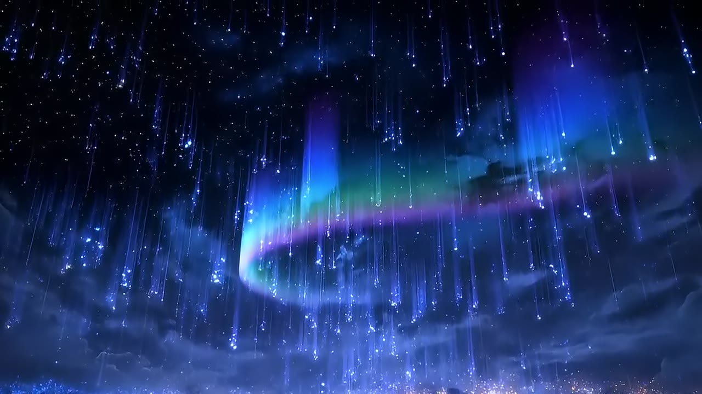
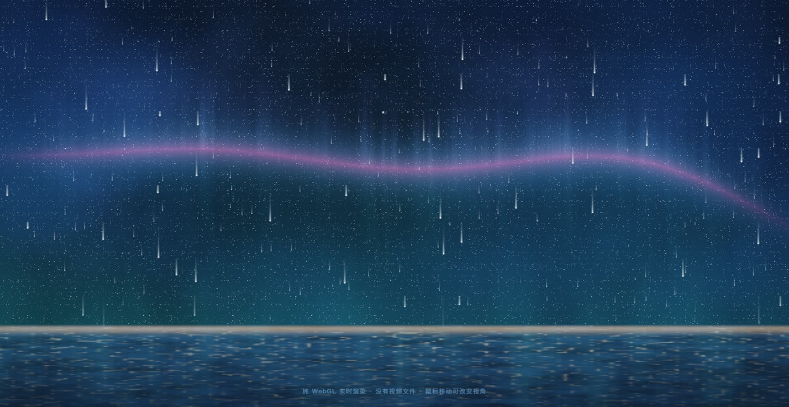

# 极光星空 · Aurora Sky

一个单文件的全屏壁纸页面：极光画面无缝循环铺满窗口，配一首背景音乐，点开就是画面。

仓库里有**两个版本**，任选其一：

| | 视频版 `index.html` | 纯代码版 `aurora-webgl.html` |
|---|---|---|
| 原理 | 16.2 MB H.264 循环视频 | 一个 WebGL 片元着色器实时算出来 |
| 体积 | 16.2 MB + 8.3 MB 音乐 | **约 35 KB，零素材** |
| 分辨率 | 固定 1920×1080，窗口更大就放大（会发软） | 跟窗口像素一比一，多大都锐 |
| 观感 | 离线渲染的成品镜头，体积光/景深/粒子密度拉满 | 实时算力上限内的高度还原，风格化更强 |
| 交互 | 无 | 鼠标移动有视差 |
| 硬件 | 能播 H.264 就行 | 需要 WebGL2 + 一个不太差的 GPU |



▶ [下载/播放这段循环视频（6.3s · 1920×1080）](assets/aurora.mp4)



▶ [打开纯代码实时版](aurora-webgl.html)

---

## 效果

- 画面用 `object-fit: cover` / 全屏 canvas 铺满整个窗口，不拉伸、不留黑边，多余部分居中裁掉
- 视频静音自动循环，这是浏览器唯一允许的自动播放形式，不会失败
- 背景音乐优先尝试自动播放；被浏览器策略拦下时，会**先静音循环**，然后**鼠标一动 / 按任意键 / 滚轮一滚**立刻出声，并显示一行「点击任意位置播放音乐」的提示
- 页面中间预留了文字层（`.content`），默认是空的，想加字直接写进去，自带呼吸动画

## 文件

```
index.html            视频版页面，所有逻辑都在里面，无任何外部依赖
aurora-webgl.html     纯代码版页面，全部画面由 WebGL 着色器实时生成
assets/aurora.mp4     极光循环视频  1920×1080 / 30fps / 6.3s / H.264 / 16.2 MB
assets/falling.mp3    背景音乐      320 kbps / 44.1 kHz / 3:36 / 8.3 MB
assets/preview.jpg    视频版预览图，页面不引用，可以删
assets/preview-code.jpg  代码版预览图，同上
```

## 怎么用

### 方式一：本地直接打开

下载整个仓库，双击 `index.html`（视频版）或 `aurora-webgl.html`（代码版）即可。不需要服务器、不需要联网、不依赖任何 CDN 或外链。

### 方式二：GitHub Pages

仓库 `Settings → Pages → Source 选 main 分支 / (root)`，保存后访问 `https://<你的用户名>.github.io/<仓库名>/`。

### 方式三：当桌面壁纸

用 Edge / Chrome 的「应用窗口」方式打开，没有地址栏和标签页，看着就是一张会动的壁纸：

```bat
msedge.exe --app="file:///C:/path/to/index.html" --window-size=1536,864 --window-position=0,0
```

`F11` 全屏。

## 纯代码版：画面是怎么算出来的

`aurora-webgl.html` 里没有一张图、没有一帧视频，整幅画面由 4 个 pass 在每一帧重新生成：

1. **场景 pass** —— 一个片元着色器画完整个天空：
   - 星空：3 层 hash 网格，各自带独立闪烁相位
   - 星落：3 层不同密度/速度的下坠光点，每颗带向下衰减的拖尾
   - 极光：先由 `arcY()` 定出一条横贯画面的弧线，再用两层 FBM 噪声在高频 X、低频 Y 上取竖直帘幕，乘一个低频包络让某几处炸开成光柱；颜色沿高度从青绿过渡到紫，弧核单独叠品红
   - 水面：FBM 波纹 + 竖向倒影条纹 + 水线附近的暖色灯火颗粒
   - 最后 ACES 色调映射 + 2.2 伽马 + 抖动去色带
2. **亮部提取 pass** —— 1/4 分辨率，阈值以上的像素单独拎出来
3. **两趟高斯模糊 pass** —— 横、纵各一趟，做泛光
4. **合成 pass** —— 场景 + 泛光，输出到屏幕

性能自适应：连续采样帧时间，超过 22 ms 就自动把内部渲染分辨率降到 0.85 / 0.7 / 0.55，低于 11 ms 再升回去。想锁定画质可以直接加参数：

```
aurora-webgl.html?q=1      # 强制满分辨率，关掉自动降级
aurora-webgl.html?q=0.7    # 固定 70% 内部渲染分辨率
```

实测（Radeon Vega 8 集显，窗口 1915×989 物理像素）：`?q=1` 满分辨率稳定 **60 fps**。

## 关于「音乐没有自动响」


这不是 bug。所有 Chromium 内核浏览器（Chrome / Edge）默认策略都是**禁止有声自动播放**，必须有一次用户交互。本页面已经做了三层兜底：

1. 页面一加载就尝试 `play()`
2. 失败 → 静音循环播放（浏览器允许），保证进度条在走
3. 监听 `pointerdown / pointermove / keydown / wheel / touchstart / scroll`，任意一个触发就立刻 `muted = false` 出声，并隐藏提示

如果你自己的机器上希望**彻底零交互出声**，可以放开浏览器策略（只影响你自己的浏览器）：

- Edge：`edge://settings/content/mediaAutoplay` → 添加允许站点（`file://` 或你的 Pages 域名）
- 或用组策略：`HKCU\Software\Policies\Microsoft\Edge` 下新建 DWORD `AutoplayAllowed = 1`

## 换成你自己的素材

1. 替换 `assets/aurora.mp4`。**必须是 H.264 (avc1) 编码的 MP4**，HEVC/H.265 在 Windows 版 Chrome/Edge 上大概率解不出来，页面会一片黑。
2. 替换 `assets/falling.mp3`。
3. 想改文案，编辑 `index.html` 里这个 div：

```html
<div class="content"></div>
```

比如：

```html
<div class="content">今晚的星空，留给你</div>
```

字号、颜色、字体都在 `.content` 的 CSS 里，`font-size` 用了 `clamp()`，会跟着窗口宽度自适应。

## 技术说明

- **视频编码**：H.264 High / 1288×720 原始素材，lanczos 升采样到 1920×1080，`SAR 1:1`，这样在全屏 1080p 下浏览器几乎不做缩放，是 1:1 直出像素，最锐
- **循环衔接**：结尾 0.7 秒和开头 0.7 秒交叉淡化，循环点看不出跳帧
- **去色带**：编码时加了 `deband` 滤镜，暗部渐变不会出现阶梯状色带
- **零依赖**：一个 HTML 文件 + 两个媒体文件，没有框架、没有 CDN、没有构建步骤

## 素材来源

- 视频：极光素材，重新编码为浏览器通用格式
- 音乐：《下坠Falling》— 霓虹兔，版权归原作者及唱片公司所有，此处仅作个人演示使用

## License

代码部分 MIT，见 [LICENSE](LICENSE)。媒体素材版权归各自原作者。
